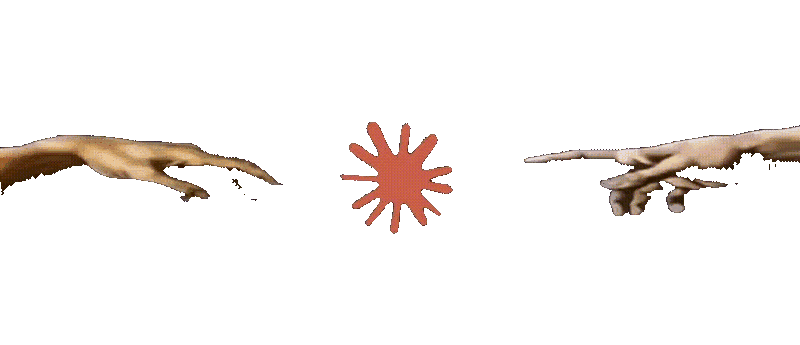

<h1 align="center">DesktopPet</h1>

<p align="center">
  
</p>

<p align="center">
  <b>A pixel pet rendered in a transparent macOS overlay.</b>
</p>

<p align="center">
  
  
  
  
  <a href="https://github.com/lavochkaa/DesktopPet/actions/workflows/ci.yml">
    
  </a>
</p>

## Status

DesktopPet is an early learning project. The current app displays a single pixel pet in a borderless transparent window above the Dock. It idles, may blink, takes short walks, stretches on a cooldown, and jumps when clicked.

The current behavior loop is deliberately small:

```text
idle → walk → idle → stretch → idle
```

Idle timing, blinking, walking direction, and walking distance are randomized. Stretch is offered on a 2-minute cooldown. The behavior system does **not** yet use weighted scene selection.

## Current features

- Transparent, borderless floating window using the display's visible frame
- Click-through outside an expanded hit area around the pet
- Pixel-art rendering with `SKTexture.filteringMode = .nearest`
- Idle animation with a random blink
- Short walks in either direction
- Walking range calculated from the SpriteKit scene and a hand-tuned Dock inset
- Walk durations stretched to whole animation cycles, so a walk does not end mid-step
- Stretch animation offered after idle, gated by a 2-minute cooldown
- Jump animation when the pet is clicked
- `energy`, `curiosity`, and `arousal` meters updated after completed idle and walk scenes

The project currently has no network calls, external integrations, tracking, or LLM features.

## Behavior status

`PetBrain` currently chooses between `idle`, `walk`, and `stretch` (the latter gated by a cooldown, not by meters). The meters are stored and updated, but they do not yet influence the choice of the next scene.

The design for the next version is documented in [`docs/superpowers/specs/2026-10-16-pet-brain-design.md`](docs/superpowers/specs/2026-10-16-pet-brain-design.md). It proposes weighted choices, `stretch` and `sleep` scenes, plus `shyness` and cooldown rules. Those parts are not implemented yet.

## Architecture

```text
DesktopPet/
├── App/
│   ├── AppDelegate.swift
│   └── ViewController.swift
├── Behavior/
│   ├── PetBehavior.swift
│   ├── PetBrain.swift
│   └── PetTuning.swift
├── Input/
│   └── MousePassthroughController.swift
└── Scene/
    ├── PetScene.swift
    ├── PetAnimations.swift
    ├── PetFrames.swift
    └── PetScreen.swift
```

`App` configures the overlay. `Scene` owns SpriteKit and screen-layout details. `Behavior` contains the idle/walk decision loop and its data. `Input` handles click-through behavior.

## Assets

Animation frames are stored in `DesktopPet/Assets.xcassets`:

```text
walk_0001 ... walk_0008
blink_0001 ... blink_0005
jump_0001 ... jump_0010
stretch_0001 ... stretch_0010
```

The pet is drawn at 32×32 px and scaled in `PetScene`. Every loaded texture uses:

```swift
texture.filteringMode = .nearest
```

Source frames, including animations that are still work in progress, live in
the `resources/` working directory. Only `Assets.xcassets` is compiled into the
app; `resources/` is kept for editing and is not referenced at runtime.

## Build and run

The project deployment target is macOS 26.5 and it uses Swift 5.

Open `DesktopPet.xcodeproj` in Xcode, choose the `DesktopPet` scheme and the `My Mac` destination, then press `Cmd+R`.

```bash
# Build
xcodebuild -project DesktopPet.xcodeproj -scheme DesktopPet -configuration Debug build

# Run the existing test target
xcodebuild -project DesktopPet.xcodeproj -scheme DesktopPet test
```

The test target currently contains only Xcode's starter test. Behavior tests have not been written yet.

## Manual check after a behavior change

1. Launch the app: the overlay should have no white background.
2. Click outside the pet: the click should reach the app behind the overlay.
3. Click the pet: it should play the jump animation and resume its loop.
4. Watch a walk in both directions: it should remain inside the configured horizontal range and finish on an animation-cycle boundary.

## Roadmap

- [x] Transparent overlay and click-through input
- [x] Idle, blink, walk, and click-jump animations
- [x] Base `energy`, `curiosity`, and `arousal` meters
- [x] `stretch` scene with cooldown
- [ ] Weighted scene selection driven by meters and context
- [ ] `sleep` scene
- [ ] `shyness` reaction and cooldowns
- [ ] Behavior tests

Out of scope for v1: LLM features, sound, physics, settings, launch at login, multi-monitor support, and integrations with email, calendars, Spotify, or messengers.

## Contributing

Keep commits small and focused, with English imperative messages:

```text
Add blink animation
Extract pet behavior types
```

Do not commit `DerivedData`, per-user Xcode settings, credentials, or secrets.

## License

Released under the [MIT License](LICENSE).
