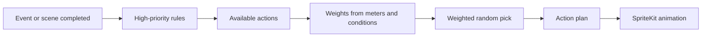

<h1 align="center">DesktopPet</h1>

<p align="center">
  
</p>

<p align="center">
  <b>An autonomous pixel pet that lives on your macOS desktop.</b><br/>
  Calm, curious, occasionally playful, and never in your way.
</p>

<p align="center">
  
  
  
  
</p>

---

## What is it?

DesktopPet is a tiny character that walks, blinks, and reacts to you right above your desktop. It has its own mood meters and a behavior system built from plain rules and weighted randomness. No LLM, no network, no tracking.

It started as a learning project to dig into **AppKit**, **SpriteKit**, the **macOS window server**, **state machines**, and animation. It is slowly growing into a small local companion with a recognizable personality.

> **Status:** early development. The core loop works and the personality is still growing.

## Personality (v1)

| Trait | What it means |
| --- | --- |
| Curious | Wanders and explores instead of standing still |
| Calm | Slow, relaxed pacing, no sudden chaos |
| Playful | Occasionally jumps or fidgets for no reason |
| Unobtrusive | Never blocks clicks or demands attention |

## Features

- Transparent, borderless overlay window above the desktop
- Click-through everywhere except the pet's own hit area
- Pixel-perfect rendering with `nearest` texture filtering
- Idle behavior with random blinking
- Short walks left and right, kept within safe screen bounds
- Movement synced to complete walk-animation cycles, so there are no mid-step stops
- Jump reaction when you click the pet
- Core meters: `energy`, `curiosity`, and `arousal`

## How it thinks

Behavior is not a hardcoded script. Each decision goes through a small pipeline:



Three meters, always clamped to `0...100`, shape the weights:

- **`energy`** is the available stamina.
- **`curiosity`** is the tendency to explore.
- **`arousal`** is the activity level (not good or bad mood).

Planned scenes: `idle`, `walk`, `stretch`, `sleep`.
Planned reactions: `blink`, `happyJump`, `shyness`.

Full design: [`docs/superpowers/specs/2026-10-16-pet-brain-design.md`](docs/superpowers/specs/2026-10-16-pet-brain-design.md)

## Architecture

```text
AppDelegate                 Configures the transparent overlay window
ViewController              Creates PetScene once window and SKView are ready,
                            owns MousePassthroughController
PetScene                    SpriteKit layer: sprite, textures, SKAction, rendering, input
PetBehavior                 Pure behavior data: states, direction, WalkPlan, meters
MousePassthroughController  Lets clicks pass through except near the pet
```

Behavior logic (`PetBehavior`) is kept separate from rendering (`PetScene`), so the "brain" stays easy to reason about and test.

## Tech stack

- **Swift 5**
- **AppKit** + **SpriteKit** (`NSWindow`, `SKView`, `SKScene`, `SKAction`)
- **Xcode**
- Aseprite / Piskel-compatible PNG animation exports

## Assets

Frames live in `Assets.xcassets` and follow this naming pattern:

```text
walk_0001 ... walk_0008
blink_0001 ... blink_0005
jump_0001 ... jump_0010
```

The pet is drawn at **32×32 px** and scaled in the scene. Pixel-art textures must always use:

```swift
texture.filteringMode = .nearest
```

## Build and run

Open `DesktopPet.xcodeproj` in Xcode, choose the `DesktopPet` scheme and the `My Mac` destination, then press `Cmd+R`.

```bash
# Build
xcodebuild -project DesktopPet.xcodeproj -scheme DesktopPet -configuration Debug build

# Tests (once implemented)
xcodebuild -project DesktopPet.xcodeproj -scheme DesktopPet test
```

<details>
<summary><b>Manual checklist after behavior changes</b></summary>

1. The app launches without a white window.
2. The overlay stays transparent.
3. Clicks pass through everywhere except the pet.
4. Clicking the pet triggers a reaction.
5. The pet walks in both directions, respects screen bounds, and stops only after a complete animation cycle.

</details>

## Roadmap

**Vision:** grow from a desktop toy into a local assistant without an LLM that notices safe system signals, develops a personality, and shows understandable reactions. The first priority is making the pet feel alive on screen. App, email, calendar, and messenger integrations come later.

- [x] Transparent overlay with click-through
- [x] Idle, blink, walk, and click-jump
- [x] Base meters (`energy`, `curiosity`, `arousal`)
- [ ] Weighted decision pipeline
- [ ] `stretch` and `sleep` scenes
- [ ] `shyness` reaction
- [ ] Tests for `PetBehavior`

**Out of scope for v1:** LLM features, sound and physics, settings, launch at login, multi-monitor support, and integrations with email, calendars, Spotify, or messengers.

## Contributing

Keep commits small and focused, with English imperative messages:

```text
Add blink animation
Extract pet behavior types
```

Please don't commit `DerivedData`, per-user Xcode settings, credentials, or secrets.

## License

Released under the [MIT License](LICENSE).